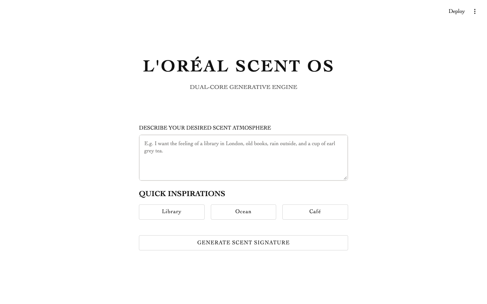
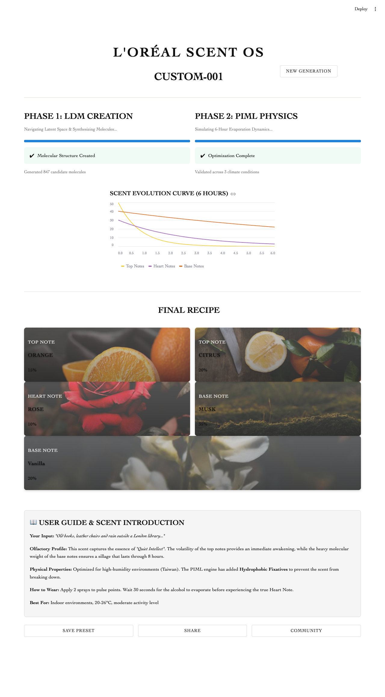

# L'ORÉAL SCENT OS

A Streamlit interface prototype for a concept product: describe an atmosphere in words and receive a personalized fragrance recipe.

> **Disclaimer:** This is an independent student concept project. It is not affiliated with, endorsed by, or sponsored by L'Oréal. The L'Oréal name is a trademark of its owner and is used here only to describe the concept.

> **Prototype status:** The interface is real; the intelligence behind it is simulated. No model runs. The progress bars, the "847 candidate molecules" and "3 climate conditions" captions, the five-ingredient recipe and the evaporation curve are all fixed values that do not depend on the user's text. Community presets are sample data.





## What the prototype shows

| Screen | Behavior |
|---|---|
| Generator | Free-text scent description, then a two-phase loading sequence presented as molecule generation and physics optimization |
| Result | Six-hour evaporation curve for top, heart and base notes, a five-ingredient recipe with image cards, and a wearing guide |
| Community | Sample presets with search, sort, download and preview controls |
| My Presets | Saves generated recipes for the current session, with regenerate, delete and export controls |

The evaporation chart plots three fixed exponential decays, one per note layer. Saved presets live in `st.session_state`, so they disappear when the session ends. Search, sort, download, preview and export are visual only.

## What I focused on

- Multi-page navigation in a single Streamlit script, driven by `st.session_state`
- A custom visual system in CSS: typography, image cards with overlays, hover states
- Responsive layout for phones

## Run it

```bash
python3 -m venv .venv
source .venv/bin/activate
pip install -r requirements.txt
streamlit run app.py
```

Ingredient images load from Unsplash, so the recipe cards need network access.

## Known issue

The Library, Ocean and Café quick-inspiration buttons do not fill the text box in current Streamlit versions. Type a description instead.

## Tech stack

Python, Streamlit, pandas, NumPy

## 中文說明

**L'ORÉAL SCENT OS** 是以 Streamlit 製作的概念產品介面原型：使用者用文字描述想要的氛圍，系統呈現一份個人化香氛配方。

**聲明：** 本專案為學生個人概念作品，與 L'Oréal 無任何關聯，亦未獲其授權或贊助。

**原型狀態：** 介面是實作的，背後的智慧功能則是模擬。程式沒有執行任何模型；進度條、分子數量說明、五種成分配方與揮發曲線都是固定內容，不會隨使用者輸入改變，社群頁也是範例資料。本專案的重點是介面與互動設計：以 `st.session_state` 管理多頁流程、自訂 CSS 視覺系統，以及手機版排版。
